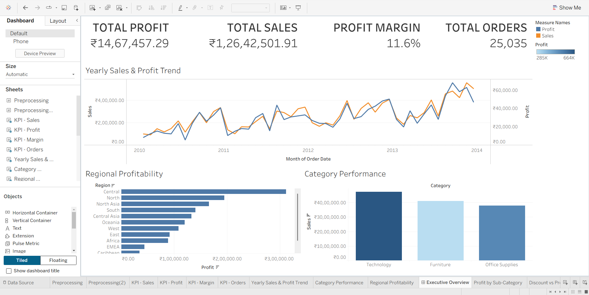
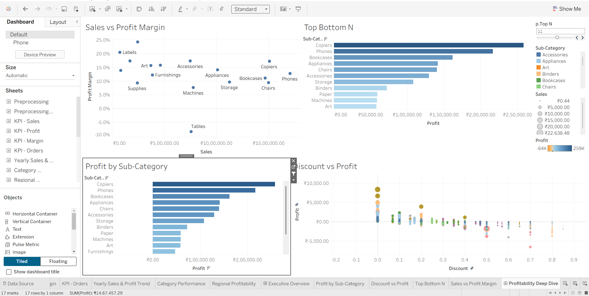
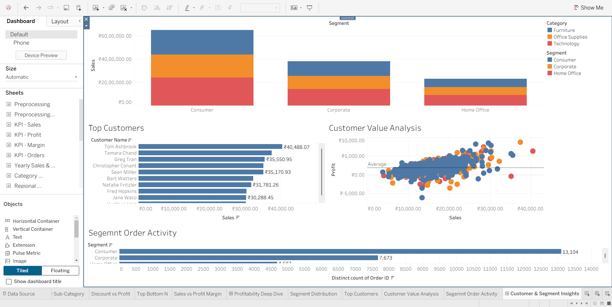

# Global Superstore Sales & Profitability Analytics (Tableau)

An interactive Tableau project that turns the **Global Superstore** dataset (51,290 order lines, 24 columns) into three dashboards answering: _How is the business doing? Where is profit made or lost? Who are the key customers?_

**Dataset:** [Global Super Store Dataset on Kaggle](https://www.kaggle.com/datasets/apoorvaappz/global-super-store-dataset/)

## Dashboards

### 1. Executive Overview

- KPI cards: **Total Sales**, **Total Profit**, **Profit Margin (11.6%)**, **Total Orders (25,035)**
- Yearly Sales & Profit Trend (dual-axis line chart, monthly)
- Regional Profitability (sorted bar chart)
- Category Performance (sales by category, coloured by profit)

### 2. Profitability Deep Dive

- Sales vs Profit Margin by sub-category (scatter)
- Top / Bottom N sub-categories (controlled by the `p.Top N` parameter)
- Profit by Sub-Category (ranked bar)
- Discount vs Profit (scatter)
- Filter action **Investigate Profit**: selecting a sub-category filters the two scatter plots

### 3. Customer & Segment Insights

- Sales by Segment, stacked by Category
- Top Customers (bar)
- Customer Value Analysis (sales vs profit, with average line)
- Segment Order Activity (distinct orders per segment)

## Key Insights

- Overall margin is **11.6%** on about 1.26 crore in sales across **25,035 orders**.
- **Central** is the most profitable region; **Copiers** and **Phones** lead sub-category profit.
- **Tables** runs at a negative margin despite solid sales.
- Profit is highest at zero discount and drops to zero or loss at discounts of about **0.5 and above**.
- **Consumer** is the largest segment (13,104 orders), followed by Corporate (7,673) and Home Office (4,687).

## Techniques Used

- Calculated fields: Profit Margin = `SUM(Profit) / SUM(Sales)`, Total Orders = `COUNTD([Order ID])`
- Dual-axis charts, parameters, reference lines, colour and size encodings
- Tiled dashboard layouts with containers
- Dashboard filter actions

## Screenshots

## How to Use

1. Download the dataset from the Kaggle link above.
2. Open the Tableau workbook in this repository (Tableau Desktop or Tableau Public).
3. If prompted, re-point the data source to your downloaded file.
4. Open the dashboard tabs and click charts, legends and the Top N slider to explore.

## Note

The original dataset is in US dollars. The workbook shows a rupee symbol because of the number format chosen in Tableau.

## Author

**Saifeel Vahora**, B.Tech, A.D. Patel Institute of Technology (CVM University)
